<section class="desktop-hero desktop-only">
  

    
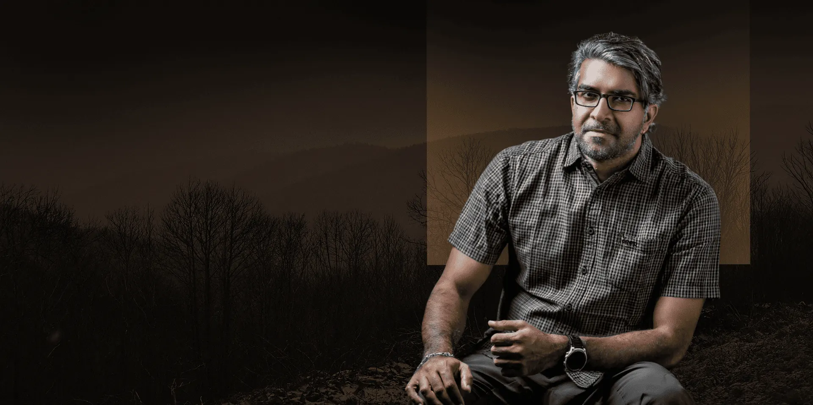

    

      

        <h1 class="hero-heading">South India Tours & Beyond</h1>
        
Personalized journeys across Kerala and Tamil Nadu with premium vehicles and unmatched hospitality.

        <a href="https://wa.me/919400620615" class="luxury-btn">Plan Your Journey</a>
      

    

  

  

    
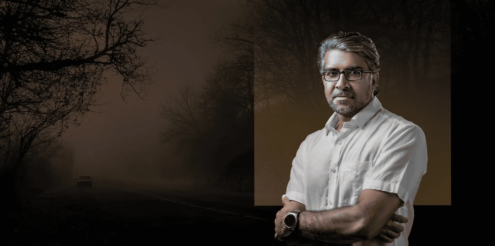

    

      

        <h2 class="hero-heading">Kerala & Tamil Nadu Escapes</h2>
        
Custom holidays, cultural heritage tours, and spiritual pilgrimages across South India.

        <a href="https://wa.me/919400620615" class="luxury-btn">Discover Packages</a>
      

    

  

  

    
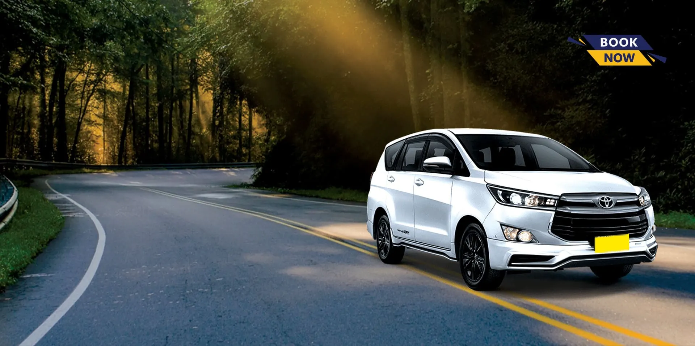

    

      

        <h2 class="hero-heading">Kochi Airport Transfers</h2>
        
Reliable 24/7 premium airport pickup and drop services with professional chauffeurs.

        <a href="https://wa.me/919400620615" class="luxury-btn">Book Your Ride</a>
      

    

  

</section>

<section class="mobile-video-hero mobile-only">
  

    <video id="catVideo" src="/maxx-welcome-kochi-airport.mp4" poster="/images/maxx-welcome-kochi-airport-poster.webp" width="720" height="1280" autoplay muted playsinline preload="metadata" aria-label="Maxx the cat welcomes you to Kochi Airport with a Tour With Anand sign"></video>
    <button type="button" class="m-sound-btn" id="catSoundBtn" aria-label="Play video with sound">🔊Tap for sound</button>
    
    

      <h3>Hi, I'm Maxx! 🐾</h3>
      
Connect with my friend Anand for the best trip.

    

  

  
</section>

<section class="promise-section" id="our-promise">
  

    Our Promise
    <h2 class="promise-title">No blunders. No excuses. Only premium service.</h2>
    
We treat every guest in the most premium way, and every step we take is built to earn your trust.

  

</section>

<section class="why-section" id="why-anand">
  

    <h2 class="section-title">Why Travel With Anand</h2>
    
A personal, premium welcome to Kerala, and a team that looks after every detail of your journey.

    

      

        
      

      

        Meet Your Host
        <h3>Anand</h3>
        
Founder, Tour With Anand &middot; Kochi, Kerala

        <blockquote>&ldquo;I personally receive my guests at Kochi Airport, so your journey in Kerala begins with a familiar face and a warm welcome.&rdquo;</blockquote>
        <ul class="founder-points">
          <li>Personal welcome at Kochi Airport</li>
          <li>Video call before you book</li>
          <li>One point of contact for your whole trip</li>
        </ul>
      

    

    

      

        <svg class="why-icon" viewBox="0 0 24 24" aria-hidden="true"><path d="M22 10 12 5 2 10l10 5 10-5z"/><path d="M6 12v5c3 2 9 2 12 0v-5"/></svg>
        <h3>Educated, Experienced Team</h3>
        
Our team members support you with every part of your travel, from planning to drop-off.

      

      

        <svg class="why-icon" viewBox="0 0 24 24" aria-hidden="true"><path d="M12 3l1.9 5.8L20 10l-5 3.9L16.2 20 12 16.6 7.8 20 9 13.9 4 10l6.1-1.2z"/></svg>
        <h3>Hygienic, Well-Kept Cabs</h3>
        
Clean, hygienic and well-maintained vehicles on every trip.

      

      

        <svg class="why-icon" viewBox="0 0 24 24" aria-hidden="true"><path d="M23 7l-7 5 7 5V7z"/><rect x="1" y="5" width="15" height="14" rx="2"/></svg>
        <h3>Video Call Our Team</h3>
        
Talk face to face with our team on Google Meet or WhatsApp video whenever you like.

      

      

        <svg class="why-icon" viewBox="0 0 24 24" aria-hidden="true"><path d="M12 22s8-4 8-10V5l-8-3-8 3v7c0 6 8 10 8 10z"/><path d="M9 12l2 2 4-4"/></svg>
        <h3>Trust &amp; Quality First</h3>
        
A trust-building, quality-driven service from your first message to the final drop-off.

      

      

        <svg class="why-icon" viewBox="0 0 24 24" aria-hidden="true"><path d="M1 12s4-8 11-8 11 8 11 8-4 8-11 8-11-8-11-8z"/><circle cx="12" cy="12" r="3"/></svg>
        <h3>Transparent in Everything</h3>
        
Clear plans, clear pricing and clear communication. No hidden charges.

      

    

  

</section>

<section class="process-section" id="how-we-work">
  

    Premium service, start to finish
    <h2 class="section-title">How We Work</h2>
    
From your first message to the final drop-off, every step is personal, transparent and planned around you.

    <ol class="process-steps">
      <li class="process-step">
        1
        

          <h3>Reach Us Your Way</h3>
          
Call, WhatsApp, email, or come through a friend's referral. Anand's team replies personally.

        

      </li>
      <li class="process-step">
        2
        

          <h3>Share Your Complete Plan</h3>
          
Tell us your dates, travellers, hotels and the places you want to see. We listen to every detail.

        

      </li>
      <li class="process-step">
        3
        

          <h3>Get Your Best Fixed Price</h3>
          
We study your requirements and send one all-inclusive quote. No hidden charges, ever.

        

      </li>
      <li class="process-step step-highlight">
        4
        

          Before you book
          <h3>Meet Your Driver on Video</h3>
          
Video call us on Google Meet or WhatsApp. See the car, talk to the driver, and choose who drives you.

        

      </li>
      <li class="process-step">
        5
        

          <h3>Confirm &amp; Relax</h3>
          
Once you confirm, a dedicated team looks after you, with one point of contact for your whole trip.

        

      </li>
      <li class="process-step">
        6
        

          <h3>Journey Completed, Exactly as Promised</h3>
          
We deliver everything we quoted and close every trip cleanly. No surprises at the end.

        

      </li>
    </ol>

    

      <a href="https://wa.me/919400620615?text=Hello%20Anand,%20I%20would%20like%20a%20video%20call%20to%20discuss%20my%20trip%20and%20meet%20the%20driver." class="luxury-btn">Book a Video Call</a>
      <a href="tel:+919400620615" class="luxury-btn-outline">Call Anand</a>
    

  

</section>

<section class="fleet-section">
  

    <h2 class="section-title">Our Premium Fleet</h2>
    
Travel in pristine comfort. From executive sedans to luxury coaches, select the perfect vehicle for your South Indian journey.

        
Fares depend on your route, dates and group size. Every quote includes toll, parking, entry fees, and driver allowance — no hidden charges. Contact us on WhatsApp for an exact quote.

    

      

        
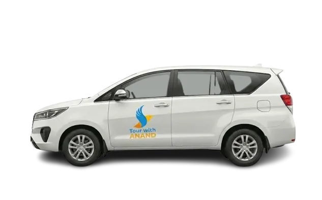

        <h3>Innova Crysta</h3>
        Executive comfort for families and long journeys.
                
Fare on request · <a href="https://wa.me/919400620615?text=Hello%20Anand,%20I%20would%20like%20a%20quote%20for%20a%20Innova%20Crysta." class="price-link">Get a quote on WhatsApp</a>

      

      

        
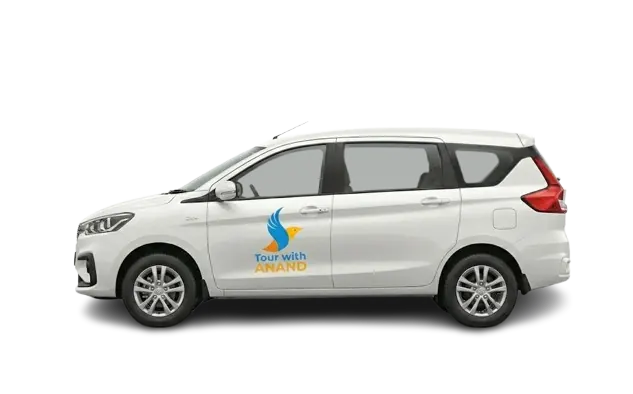

        <h3>Maruti Ertiga</h3>
        Spacious and affordable for up to 5 passengers.
                
Fare on request · <a href="https://wa.me/919400620615?text=Hello%20Anand,%20I%20would%20like%20a%20quote%20for%20a%20Maruti%20Ertiga." class="price-link">Get a quote on WhatsApp</a>

      

      

        
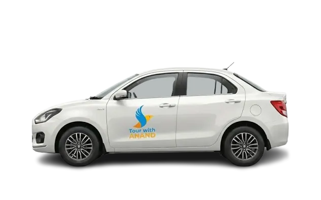

        <h3>Premium Sedan</h3>
        Perfect for swift city travel and airport transfers.
                
Fare on request · <a href="https://wa.me/919400620615?text=Hello%20Anand,%20I%20would%20like%20a%20quote%20for%20a%20Premium%20Sedan." class="price-link">Get a quote on WhatsApp</a>

      

      

        
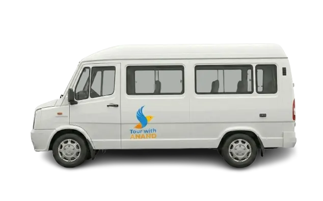

        <h3>Tempo Traveller</h3>
        Ideal for group tours and extended family trips.
                
Fare on request · <a href="https://wa.me/919400620615?text=Hello%20Anand,%20I%20would%20like%20a%20quote%20for%20a%20Tempo%20Traveller." class="price-link">Get a quote on WhatsApp</a>

      

      

        
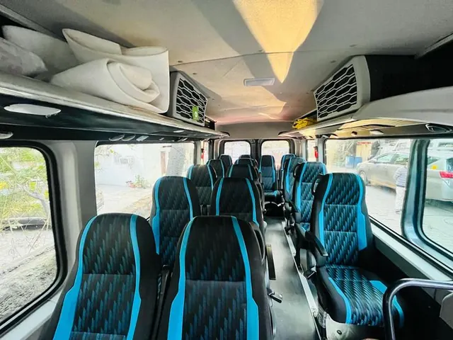

        <h3>Luxury Coach</h3>
        Premium transportation for large corporate groups.
                
Fare on request · <a href="https://wa.me/919400620615?text=Hello%20Anand,%20I%20would%20like%20a%20quote%20for%20a%20Luxury%20Coach." class="price-link">Get a quote on WhatsApp</a>

      

    

  

</section>

<section class="destinations-section">
  

    <h2 class="section-title">Explore Top Destinations</h2>
    
Discover the most breathtaking attractions and hidden gems across our specialized tour routes in South India.

    
    

      

        <picture>
          <source media="(max-width: 768px)" srcset="/images/places-to-visit-kerala-mobile.webp">
          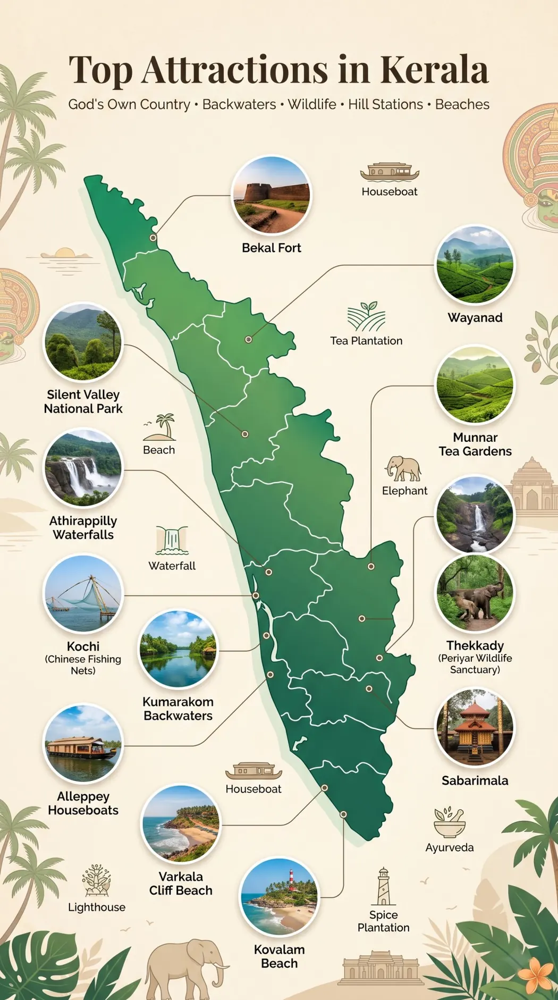
        </picture>
      

      

        <picture>
          <source media="(max-width: 768px)" srcset="/images/places-to-visit-tamilnadu-mobile.webp">
          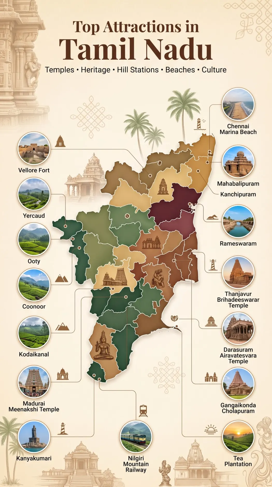
        </picture>
      

      

        <picture>
          <source media="(max-width: 768px)" srcset="/images/places-to-visit-karnataka-mobile.webp">
          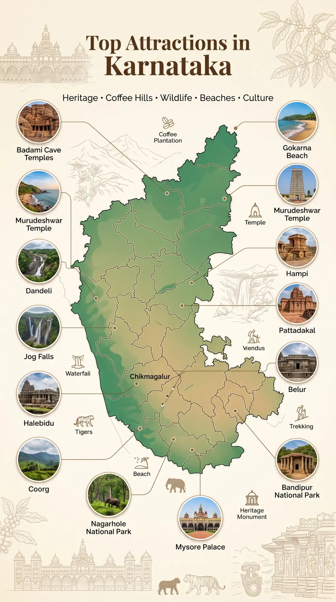
        </picture>
      

    

  

</section>

<section class="packages-section">
  

    <h2 class="section-title">Kerala &amp; South India Tour Packages</h2>
    
Private, chauffeur-driven itineraries starting from Kochi Airport. Every package can be customised to your dates, hotels and pace.

    

      
      
      <a href="{{ tour.url }}" class="link-card">
        <h3>{{ tour.package_name | default: tour.title | split: " | " | first }}</h3>
        {{ tour.duration }} &middot; {{ tour.destinations }}Tamil Nadu temple pilgrimage
      </a>
      
    

    

      <a href="/south-india-tours/" class="luxury-btn-outline">Explore South India Tours</a>
    

  

</section>

<section class="unesco-section">
  

    <h2 class="section-title">World Heritage Trails</h2>
    

      <picture>
        <source media="(max-width: 768px)" srcset="/images/places-to-visit-unesco-hertiage-places-in-south-india.webp">
        
      </picture>
    

    

      
Discover the monumental legacy of South India. Our bespoke heritage tours guide you through the architectural marvels of the Cholas, Hoysalas, and Vijayanagara empires.

      <a href="https://wa.me/919400620615" class="luxury-btn-outline">Plan a Heritage Tour</a>
    

  

</section>

<section class="message-section">
  

    

      
    

    

      <h2 class="section-title" style="text-align:left;">A Personal Welcome</h2>
      
My name is Anand, and I personally oversee every journey to ensure your experience in South India is nothing short of exceptional.

      
From the moment you land at Kochi Airport, my team provides pristine vehicles, highly experienced chauffeurs, and complete transparency. We cater to guests from Europe, the Middle East, and Southeast Asia, understanding the nuances of international hospitality.

      
When you travel with us, you are not just a client; you are a personal guest.

      

        Warmest regards, 
        Anand 
        Founder, Tour With Anand
      

    

  

</section>

<section class="guest-gallery-section">
  

    <h2 class="section-title">Moments of Joy</h2>
    
Real memories captured by our guests on their journeys through South India.

    

      
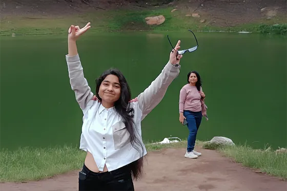

      
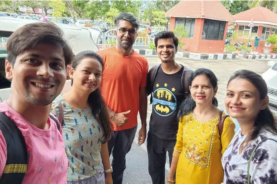

      
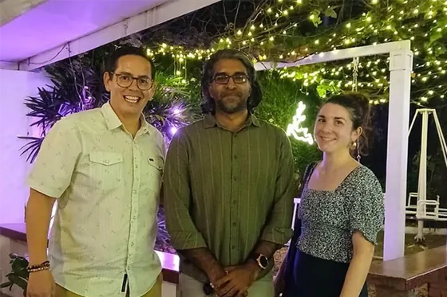

      
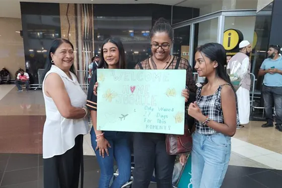

      
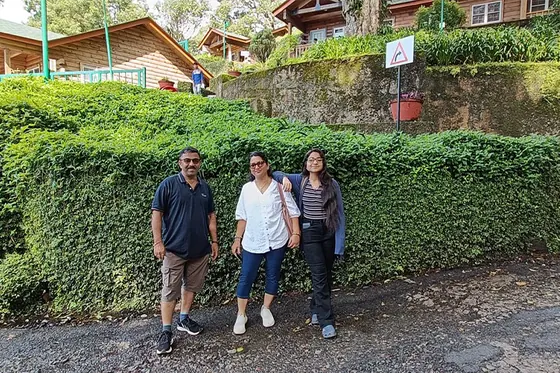

      

      
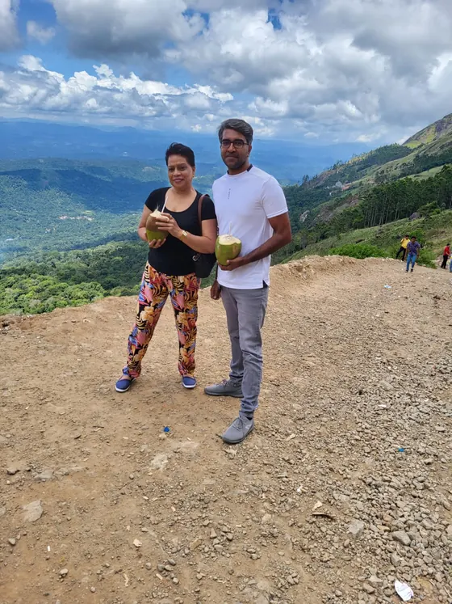

      
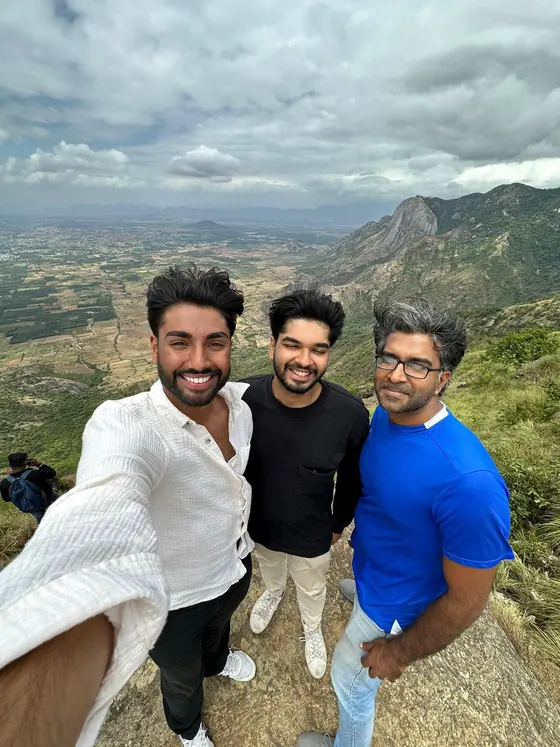

      
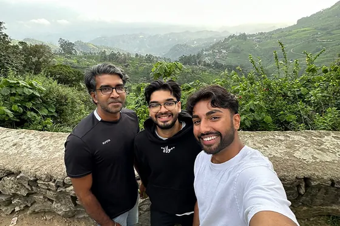

      
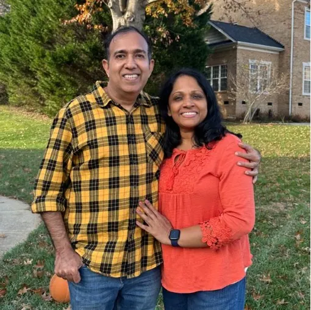

      
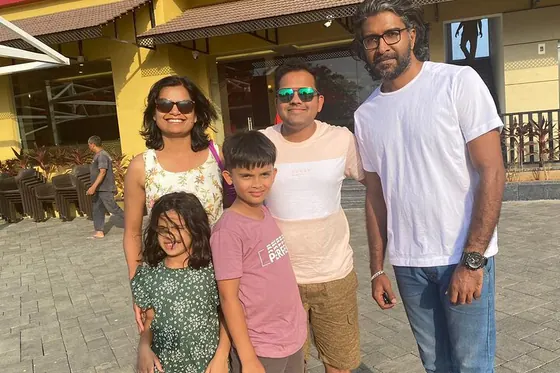

      
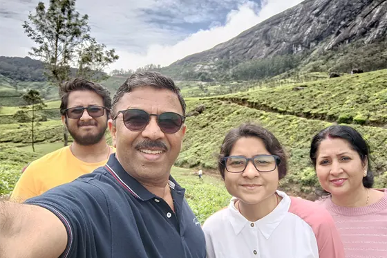

      
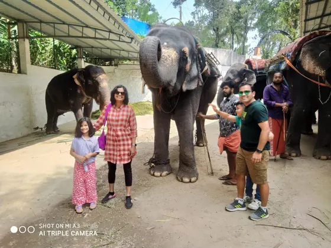

      
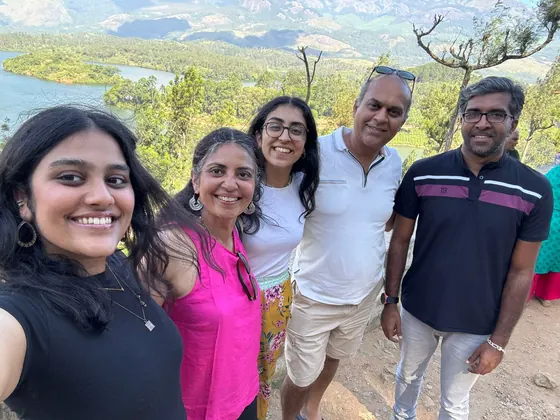

      
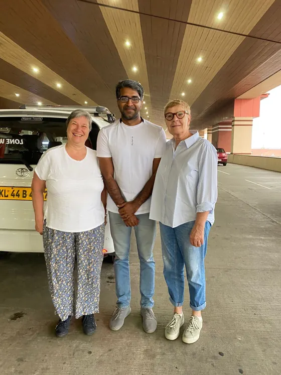

      
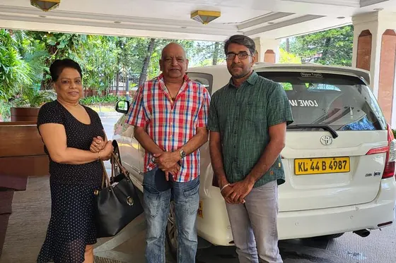

    

  

</section>

<section class="review-section">
  

    <h2 class="section-title">What Our Guests Say</h2>
    
Read firsthand experiences from international and domestic travelers who explored India with us.

    

      

        
“Our Kerala trip with Anand was absolutely smooth and stress-free. From airport pickup to hotel check-ins, everything was handled perfectly.”

        <strong>Daniel R</strong>
        Germany
      

      

        
“We booked a 7-day Kerala tour with Tour With Anand and it exceeded our expectations. Clean vehicle and excellent guidance.”

        <strong>Nur Aisyah</strong>
        Malaysia
      

      

        
“Anand is not just a driver, he is a true travel guide. He helped us explore hidden viewpoints and local culture.”

        <strong>Thomas & Eva</strong>
        France
      

      

        
“Traveling with elders felt completely safe. Anand was polite, professional, and very supportive throughout.”

        <strong>Ravi K</strong>
        Bangalore
      

      

        
“Everything was exactly as promised. No hidden charges and very honest service.”

        <strong>Lim Wei Chen</strong>
        Singapore
      

      

        
“Even though our flight was delayed, Anand waited patiently at Kochi Airport. Very reliable service.”

        <strong>Fatima A</strong>
        Dubai
      

      

        
“Our honeymoon trip was beautifully planned. Great suggestions and smooth travel.”

        <strong>Suresh & Anjali</strong>
        Chennai
      

      

        
“The Alleppey houseboat arranged by Anand was excellent and well maintained.”

        <strong>Michael P</strong>
        United Kingdom
      

      

        
“Very safe driving even in hill areas. We felt comfortable throughout.”

        <strong>Ahmed S</strong>
        Qatar
      

      

        
“Anand was very friendly with our children and adjusted plans for our comfort.”

        <strong>Priya N</strong>
        Hyderabad
      

    

  

</section>

<section class="blog-section">
  

    <h2 class="section-title">Travel Tips & Stories</h2>
    
Helpful travel guides, taxi tips and destination insights to plan your South India journey with confidence.

    

          <a href="/blog/kerala-car-with-driver-taxi-guide/" class="blog-card">
          <h3>Car with Driver in Kerala: 2026 Guide</h3>
          Vehicles, how taxi fares work, routes and a 7-day loop by car
          </a>
          <a href="/blog/kerala-travel-tips-international-travelers/" class="blog-card">
          <h3>Kerala Travel Tips for International Travelers</h3>
          What every foreign visitor should know before visiting Kerala
          </a>
          <a href="/blog/ultimate-kerala-guide-first-timers/" class="blog-card">
          <h3>The Ultimate First-Timer's Guide to Kerala</h3>
          Luxury travel tips and itinerary planning for Kerala
          </a>
          <a href="/blog/kochi-airport-to-munnar-taxi-fare-guide/" class="blog-card">
          <h3>Kochi Airport to Munnar Taxi Fare Guide</h3>
          Distance, travel time, route highlights and what a fair fare looks like
          </a>
          <a href="/blog/is-kerala-safe-for-tourists/" class="blog-card">
          <h3>Is Kerala Safe for Tourists?</h3>
          An honest answer for solo travellers, families and women
          </a>
          <a href="/blog/avoid-tourist-scams-kerala-tamil-nadu/" class="blog-card">
          <h3>How to Avoid Tourist Scams in Kerala & Tamil Nadu</h3>
          Fake guides, inflated taxi fares and how to avoid them
          </a>
          <a href="/blog/kochi-airport-to-sabarimala-pilgrimage-taxi/" class="blog-card">
          <h3>Kochi Airport to Sabarimala Pilgrimage Taxi Guide</h3>
          Planning your Sabarimala yatra from Cochin Airport
          </a>
    

  

</section>

<section class="faq-section">
  

    <h2 class="section-title">Frequently Asked Questions</h2>
    
Common questions asked by international travelers planning private tours in South India.

    

      

        <h3>1. Is it safe to travel in Kerala and South India by taxi?</h3>
        
Yes, traveling in Kerala and South India by private taxi is very safe. We provide well-maintained vehicles, experienced drivers, and carefully planned routes to ensure a comfortable and secure journey.

      

      

        <h3>2. How can foreigners book a taxi or tour in Kochi?</h3>
        
Foreign travelers can easily book our taxi or tour services through WhatsApp, email, or our official website. Advance booking is highly recommended.

      

      

        <h3>3. Do you provide English-speaking drivers?</h3>
        
Yes. Our drivers speak English clearly and are experienced in assisting international guests from Europe, the Middle East, Malaysia, Singapore, and beyond.

      

      

        <h3>4. Do you offer Kochi Airport pickup and drop service?</h3>
        
Yes. We provide 24×7 Kochi International Airport taxi service with flight tracking, on-time pickup, and assistance even if your flight is delayed.

      

      

        <h3>5. Are your South India tour packages customizable?</h3>
        
Yes. All South India tour packages are fully customizable based on your travel dates, interests, hotel preference, and budget.

      

      

        <h3>6. Are your taxi prices fixed or negotiable?</h3>
        
Our pricing is transparent and fixed based on distance and itinerary. There are no hidden charges, and all details are clearly explained before confirmation.

      

    

  

</section>

<section class="lead-form-section">
  

    <h2 class="section-title">Send Your Travel Enquiry</h2>
    
Planning a Kerala or South India holiday? You can contact us via WhatsApp or Email.

    

      📧 Email: <a href="mailto:infostarkholidays@gmail.com">infostarkholidays@gmail.com</a>
    

    <form onsubmit="sendWhatsApp(); return false;" class="lead-form">
      <input type="text" id="name" placeholder="Full Name" required>
      <input type="tel" id="mobile" placeholder="Mobile Number" required>
      <input type="email" id="email" placeholder="Email Address" required>
      <textarea id="message" rows="5" placeholder="Tell us about your travel plans..." required></textarea>
      
      

        <button type="submit" class="whatsapp-submit-btn">Send via WhatsApp</button>
        <a href="tel:+919400620615" class="call-submit-btn">📞 Call Now</a>
      

    </form>
  

</section>

